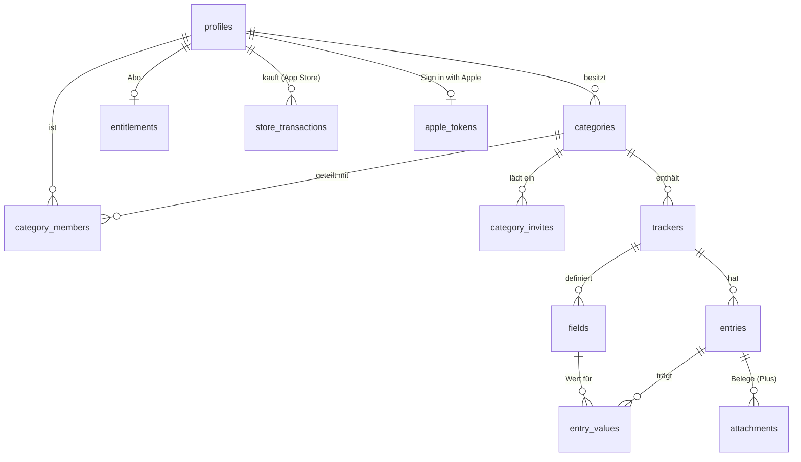

# Supabase – Backend von Kostenkurve

Postgres mit Row Level Security, RPCs für alles, was über Tabellenrechte hinausgeht, Edge Functions für Server-Logik (Kaufprüfung, Konto löschen, Sign in with Apple; später: KI-Import). Projekt-Ref: **noch nicht angelegt** – Werte kommen in `.env.local` (Repo-Wurzel, gitignored), nie ins Repo.

```
supabase/
  config.toml          lokale CLI-Konfiguration (anonyme Anmeldung aus, E-Mail-Code 10 Minuten, Redirect de.eloayoubi.kostenkurve://login-callback, verify_jwt je Edge Function)
  migrations/          Schema, eine Transaktion je Datei, Zeitstempel aufsteigend
  seed.sql             Beispieldaten (Demo, Anna) – nur lokal / in test_local.sh
  functions/health/    Lebenszeichen, ohne Anmeldung
  functions/…          weitere Edge Functions (siehe „Edge Functions“), gemeinsamer Code in functions/_shared/
  tests/smoke.sql      RLS, Teilen, Wertprüfung, Belege – rollt am Ende zurück
  tests/*.sql          ein Test je Feature (z. B. purchases.sql, apple_tokens.sql), ebenfalls mit rollback
  scripts/test_local.sh  Migrationen + Seed + Tests in einem Wegwerf-Postgres (ohne Docker)
```

## Datenmodell



| Tabelle | Inhalt |
|---|---|
| `profiles` | ein Eintrag je Auth-Nutzer (auch anonym), Anzeigename fürs Teilen. Legt der Trigger `on_auth_user_created` an. |
| `categories` | Strom, Miete, Auto … – Einheit des Teilens. `icon`/`swatch` sind Schlüssel aus der App, `template_key` die Vorlage. |
| `category_members` | Rolle je Person: `owner` (alles, teilt, löscht), `editor` (Tracker, Felder, Einträge), `viewer` (nur lesen). Der owner kommt per Trigger dazu. `sort` ist die Reihenfolge **je Person**: geteilte Kategorien sortiert jeder für sich. |
| `category_invites` | Einladungscode (10 Zeichen, 7 Tage, einmalig) – über `create_category_invite` / `accept_category_invite`. |
| `trackers` | ein Zähler, Vertrag, Auto … innerhalb einer Kategorie. |
| `fields` | frei definierte Felder: `kind` (Text, Zahl, Betrag, Prozent, Datum, Ja/Nein, Auswahl, Formel) und `role` (Zeitverhalten: Stammdatum, Momentwert, Zählerstand, Arbeitspreis, wiederkehrender/einmaliger Betrag, Stichtag, Abschlag). Formeln stehen als Ausdruck in `formula` und werden in der App gerechnet. Ein Check erzwingt passende Kombinationen. |
| `entries` | ein Eintrag zu einem Datum, optional Abrechnungszeitraum, `meter_change` beim Zählerwechsel. |
| `trackers.included_in` | Kategorie, in deren Kosten der Tracker schon steckt (z. B. Wasser in den Nebenkosten). Die App zählt ihn dann in keiner Summe. Nie die eigene Kategorie; fällt die Ziel-Kategorie weg, wird der Wert `null`. |
| `entry_values` | typisierte Werte (`num`, `txt`, `dat`, `flag` – genau eine gesetzt). Ein Trigger prüft, dass Feld und Eintrag zum selben Tracker gehören und die Spalte zum Feldtyp passt. Formeln werden in der App berechnet, nicht gespeichert. |
| `entitlements` | Abo-Stand (`free`/`plus`; `plus` = Kostenkurve Cloud). Nur lesbar – schreiben darf nur die Service-Role (Edge Function nach Kaufprüfung). |
| `attachments` | Belege (JPEG, PNG, HEIC, PDF, ≤ 20 MB) im privaten Bucket `attachments` unter `<category_id>/<entry_id>/<datei>`. Hochladen nur mit Plus; Mitglieder sehen Belege ohne eigenes Abo. |
| `store_transactions` | App-Store-Abos von Kostenkurve Plus, eine Zeile je Abo (`original_transaction_id`) mit dem neuesten Stand: Produkt, letzte Transaktion, Ablauf, Erstattung, Umgebung, Apples Signaturzeit. Lesbar nur die eigenen; schreiben nur `apply_plus_transaction`. |
| `apple_tokens` | Refresh-Token von Sign in with Apple je Nutzer, für den Widerruf beim Löschen des Kontos. Nur Service-Role: RLS an, keine Policies, keine Rechte für anon/authenticated. |

`entitlements.source` ist `app_store`, `play_store` oder `promo`; App-Store-Käufe schreibt `apply_plus_transaction` (siehe „Kostenkurve Plus“).

## RLS in einem Satz

Sichtbar ist, was zu einer Kategorie gehört, in der ich Mitglied bin; schreiben dürfen owner und editor, solange der Schreibende oder der owner ein Cloud-Abo hat; teilen und löschen nur der owner. Die Hilfsfunktionen `category_role`, `is_category_member`, `can_edit_category`, `is_category_owner`, `tracker_category`, `entry_category`, `has_plus`, `owner_has_plus` und `has_cloud` sind `security definer` mit leerem `search_path`, damit Policies nicht rekursiv werden.

## Kostenkurve Cloud: Schreiben nur mit Abo

Lokal (nur auf dem Gerät) ist die App kostenlos und spricht nicht mit Supabase. Wer in die Cloud will, registriert sich und bucht das Abo (Produkt `…plus.monthly`, 2 € im Monat). Durchgesetzt wird das im Server (Migration `…_cloud_access.sql`), nicht in der App:

| Was | Regel |
|---|---|
| `has_cloud(category)` | Aufrufer (`has_plus()`) oder Eigentümer der Kategorie (`owner_has_plus`) hat ein laufendes Abo. Nur für Policies und Funktionen, für `anon`/`authenticated` nicht aufrufbar. |
| `can_edit_category` | owner oder editor **und** `has_cloud` – gilt damit für alle Schreib-Policies (Kategorien, Tracker, Felder, Einträge, Werte, Belege) und für `save_entry`/`create_category`. |
| Neue Kategorie | `categories_insert` verlangt das eigene Abo. |
| Teilen / Beitreten | `create_category_invite` braucht das eigene Abo, `accept_category_invite` das des Eigentümers; sonst Fehler `P0064 cloud_required` (der Code bleibt gültig). |
| Ohne Abo erlaubt | Lesen, Kategorien löschen, verlassen, Reihenfolge, Name – Export und Umzug aufs Gerät gehen immer (DSGVO Art. 17 und 20). |

Das Abo des Eigentümers reicht für den Haushalt: Mitglieder schreiben in geteilte Kategorien mit, eigene Kategorien in der Cloud brauchen ein eigenes Abo. Test: `tests/cloud_access.sql`.

## RPCs

| Funktion | Wer | Was |
|---|---|---|
| `create_category_invite(p_category, p_role = 'editor')` | owner mit Cloud-Abo | neuer Code (`text`); ohne Abo `P0064` |
| `accept_category_invite(p_code)` | angemeldet | tritt bei, liefert die Kategorie-Id; Code danach verbraucht. Hat der owner kein Abo: `P0064`, Code bleibt gültig |
| `has_plus()` | angemeldet | hat der Nutzer gerade Plus? |
| `create_category(p_name, p_icon, p_swatch, p_template_key, p_trackers)` | angemeldet | legt Kategorie, Tracker und Felder (aus einer Vorlage) in einer Transaktion an. Läuft mit den Rechten des Aufrufers; scheitert ein Feld an einem Check, bleibt nichts halb angelegt. Liefert die Id. |
| `reorder_categories(p_ids)` | angemeldet | speichert die eigene Reihenfolge (Index in `p_ids`) |
| `save_entry(p_id, p_tracker, p_occurred_on, p_note, p_meter_change, p_values, p_period_start, p_period_end)` | owner, editor | speichert einen Eintrag als Upsert unter der Id vom Gerät, mit allen Werten: Fehlende Felder verlieren ihren Wert, doppeltes Senden ändert nichts. So darf die Offline-Warteschlange beliebig oft wiederholen. `p_period_start`/`p_period_end` (optional, Standard `null`) sind der Abrechnungszeitraum, z. B. die Nebenkostenabrechnung für 2025, gezahlt 2026; das Ende darf nicht vor dem Anfang liegen. Aufrufe ohne die beiden Parameter laufen unverändert. |
| `apply_plus_transaction(p_user, p_original, p_transaction, p_product, p_expires, p_revoked, p_environment, p_signed)` | nur Service-Role (Edge Functions) | speichert den Stand eines App-Store-Abos und berechnet `entitlements` neu, liefert `{plus, valid_until}`. Fremdes Produkt: Fehler `P0063`. Siehe „Kostenkurve Plus“. |

## Schutz-Trigger

Diese Trigger gelten für angemeldete Nutzer; Server-Code ohne `auth.uid()` ist ausgenommen.

| Trigger | Regel |
|---|---|
| `categories_guard` | `owner_id` bleibt fest; archivieren und wiederherstellen darf nur der owner (umbenennen auch der editor) |
| `trackers_guard` | Tracker bleiben in ihrer Kategorie |
| `entries_guard` | Einträge bleiben in ihrem Tracker |
| `fields_guard` | Felder bleiben in ihrem Tracker; mit gespeicherten Werten wechselt der Typ nur innerhalb derselben Wertspalte (`field_storage`: Zahl/Betrag/Prozent, Text/Auswahl, Datum, Ja/Nein) |

## Realtime

Die Publikation `supabase_realtime` enthält `categories`, `category_members`, `trackers`, `fields`, `entries` und `entry_values` (Migration `…_sharing_realtime.sql`). Änderungen gehen live an alle Mitglieder einer Kategorie; wer welche Zeile bekommt, entscheidet RLS wie beim Lesen. `entitlements`, `store_transactions` und `apple_tokens` sind nicht in der Publikation.

## Edge Functions

| Funktion | `verify_jwt` | Aufgabe | Secrets |
|---|---|---|---|
| `health` | aus | Lebenszeichen `{"ok": true}`, ohne Datenbank | – |
| `verify-purchase` | an | prüft die StoreKit-2-Transaktion aus der App und meldet sie an `apply_plus_transaction`; Antwort `{plus, valid_until}` | `APPLE_BUNDLE_ID`, `APPLE_ALLOW_SANDBOX` |
| `app-store-notifications` | aus – Apple ruft ohne Supabase-Token auf, die Funktion prüft Apples Signatur | App Store Server Notifications V2 (Verlängerung, Ablauf, Erstattung, Widerruf) → `apply_plus_transaction` | `APPLE_BUNDLE_ID`, `APPLE_ALLOW_SANDBOX` |
| `delete-account` | an | löscht die Belege im Storage, widerruft Sign in with Apple, dann den Auth-Nutzer (die Kaskade löscht alle Daten); wiederholbar | optional `APPLE_TEAM_ID`, `APPLE_SIGNIN_KEY_ID`, `APPLE_SIGNIN_KEY`, `APPLE_BUNDLE_ID` |
| `apple-token` | an | tauscht den Apple-Autorisierungscode gegen ein Refresh-Token und speichert es in `apple_tokens` | `APPLE_TEAM_ID`, `APPLE_SIGNIN_KEY_ID`, `APPLE_SIGNIN_KEY`, `APPLE_BUNDLE_ID` |

`SUPABASE_URL`, `SUPABASE_ANON_KEY` und `SUPABASE_SERVICE_ROLE_KEY` setzt Supabase selbst. Die übrigen Secrets kommen per `supabase secrets set` (siehe „Einspielen“), nie ins Repo:

| Secret | Wert |
|---|---|
| `APPLE_BUNDLE_ID` | Bundle-ID der App, Standard `de.eloayoubi.kostenkurve` – zugleich `client_id` für Sign in with Apple |
| `APPLE_ALLOW_SANDBOX` | `true` (Standard): Sandbox-Käufe aus TestFlight und App Review zählen; `false`: nur noch Production |
| `APPLE_TEAM_ID` | Team-ID des Apple-Developer-Kontos (Membership) |
| `APPLE_SIGNIN_KEY_ID` | Key-ID des Sign-in-with-Apple-Schlüssels |
| `APPLE_SIGNIN_KEY` | Inhalt der `.p8`-Datei dieses Schlüssels (PEM; Zeilenumbrüche dürfen auch als `\n` dastehen) |

Fehlen `APPLE_TEAM_ID`, `APPLE_SIGNIN_KEY_ID` oder `APPLE_SIGNIN_KEY`, antwortet `apple-token` mit `{"stored": false}` und `delete-account` löscht ohne Widerruf – die App funktioniert also schon, bevor der Schlüssel existiert. Codes, Tokens und das Client-Secret werden nie geloggt.

## Kostenkurve Plus (App Store)

1. Die App kauft mit StoreKit 2 (`in_app_purchase`) und gibt die Nutzer-Id als `applicationUserName` mit; Apple trägt sie als `appAccountToken` in die Transaktion ein.
2. Die App schickt `serverVerificationData` (die von Apple signierte Transaktion, JWS) an `verify-purchase`. Die Funktion prüft Zertifikatskette und Signatur gegen die Apple Root CA - G3 (ohne Netz, `functions/_shared/apple_jws.ts`), dann Bundle-ID, Umgebung, Abo-Typ, Produkt und `appAccountToken` = angemeldeter Nutzer. Erst nach einer Antwort 200 beendet die App die Transaktion.
3. Verlängerung, Ablauf, Kündigung, Erstattung und Widerruf meldet Apple an `app-store-notifications` – so bleibt der Stand aktuell, auch wenn die App länger nicht geöffnet wird. Fehlt der `appAccountToken` oder gibt es das Konto nicht mehr, wird nur ein schon gespeichertes Abo aktualisiert.
4. Beide rufen `apply_plus_transaction` auf. Je Abo zählt der neueste Stand: Ältere Signaturen und frühere Abo-Zeiträume ändern nichts, eine Erstattung des laufenden Zeitraums gilt sofort. Danach wird `entitlements` neu berechnet: `plus` bis zum spätesten laufenden, nicht erstatteten Abo, sonst `free` (die Zeile bleibt). Ein aktives Plus aus anderer Quelle (`promo`, `play_store`), das mindestens so lange gilt, bleibt stehen.
5. `has_plus()` liest `entitlements` – daran hängen die Policies für Belege.

Produkte: `de.eloayoubi.kostenkurve.plus.monthly` und `de.eloayoubi.kostenkurve.plus.yearly` (stehen in `apply_plus_transaction` und in beiden Edge Functions). Ein Abo gehört dem Konto, das es gekauft hat: Stellt ein anderes Konto es wieder her (etwa ein neues anonymes Konto nach einer Neuinstallation), antwortet `verify-purchase` mit `403 wrong_user`. Ein laufendes Abo endet nicht mit dem Löschen des Kontos – das kündigt der Nutzer in den iOS-Einstellungen.

## App Store Connect

- Abo-Gruppe „Kostenkurve Cloud“ mit dem automatisch verlängerbaren Abo `de.eloayoubi.kostenkurve.plus.monthly` (2 € im Monat). Das Jahresabo `…plus.yearly` verkauft die App nicht mehr; der Server erkennt laufende weiter (gleiche Stufe wie das Monatsabo).
- App-Informationen → App-Store-Server-Benachrichtigungen: **Version 2**, Production- und Sandbox-URL `https://<ref>.supabase.co/functions/v1/app-store-notifications`.
- **Familienfreigabe aus**: Transaktionen von Familienmitgliedern tragen nicht deren eigene Nutzer-Id als `appAccountToken` und würden mit `wrong_user` abgelehnt.
- **Abrechnungs-Kulanzzeitraum (Billing Grace Period) aus**: berücksichtigt wird nur das Ablaufdatum.

## Sign in with Apple: Widerruf beim Löschen

App Store Review Guideline 5.1.1(v): Löscht jemand sein Konto, widerruft die App den Zugang bei Apple.

1. Nach jeder erfolgreichen Anmeldung oder Verknüpfung mit Apple (`signInWithIdToken` / `linkIdentityWithIdToken`) schickt die App den `authorizationCode` des nativen Logins an `apple-token` (5 Minuten gültig, nur einmal verwendbar).
2. `apple-token` tauscht ihn bei `https://appleid.apple.com/auth/token` gegen ein Refresh-Token und speichert es in `apple_tokens` (ein älteres wird ersetzt).
3. `delete-account` ruft vor dem Löschen `https://appleid.apple.com/auth/revoke` mit diesem Refresh-Token auf. Scheitert der Widerruf, wird trotzdem gelöscht; geloggt wird nur der Fehlercode.

Das `client_secret` für beide Aufrufe baut `functions/_shared/apple_client_secret.ts`: ein ES256-JWT, signiert mit dem `.p8`-Schlüssel (Header `kid` = Key-ID; Claims `iss` = Team-ID, `sub` = Bundle-ID, `aud` = `https://appleid.apple.com`, 5 Minuten gültig). Einrichten: Apple Developer → Certificates, Identifiers & Profiles → Keys → neuer Schlüssel mit „Sign in with Apple“ für die primäre App-ID `de.eloayoubi.kostenkurve`, `.p8` herunterladen (geht nur einmal), dann `APPLE_TEAM_ID`, `APPLE_SIGNIN_KEY_ID` und `APPLE_SIGNIN_KEY` setzen.

## Auth: Registrieren und Anmelden ohne Passwort

Die App registriert und meldet per E-Mail mit einem 8-stelligen Code an (`signInWithOtp` mit `shouldCreateUser: true` bzw. `false`, dann `verifyOTP`) oder mit Apple (`signInWithIdToken`, Nonce). Anonyme Konten gibt es nicht mehr (`enable_anonymous_sign_ins = false`); eines aus der Testphase wird beim Registrieren verknüpft (`updateUser(email)` + Code bzw. `linkIdentityWithIdToken`).

- **Vorlagen** (Dashboard → Authentication → Emails) mit **`{{ .Token }}`**: „Confirm signup“ (Registrieren, solange „Confirm email“ an ist – Standard im Dashboard; `templates/confirmation.html`), „Magic Link“ (Anmelden; bei ausgeschalteter Bestätigung auch fürs Registrieren), „Change Email Address“ (Testkonto sichern). Ohne `{{ .Token }}` steht in der Mail nur ein Link, kein Code.
- **Grenzen** (config.toml): 8 Ziffern (`otp_length = 8`, die App nimmt 6 bis 10 an), 10 Minuten gültig (`otp_expiry = 600`), neuer Code frühestens nach 60 s (`max_frequency`), höchstens 15 Code-Prüfungen je IP in 5 Minuten (`token_verifications`), Refresh-Token-Rotation an.
- **Keine Konto-Aufzählung in der App:** Beim Anmelden antwortet die App für unbekannte Adressen genauso wie für bekannte (`otp_disabled` wird nicht angezeigt). Wer `/auth/v1/otp` direkt aufruft, sieht den Unterschied weiterhin (Restrisiko; ganz weg nur mit einem gemeinsamen „Weiter mit E-Mail“, das immer anlegt).
- **Sitzung auf dem Gerät** im iOS-Schlüsselbund bzw. Android Keystore (`SecureSessionStorage`), nicht in NSUserDefaults.

## Lokal testen

```sh
supabase/scripts/test_local.sh
```

Startet ein Wegwerf-Postgres (neuestes installiertes, ≥ 14), stellt die Supabase-Umgebung nach (Rollen, `auth.users`, `auth.uid()`, `storage`), spielt alle Migrationen und den Seed ein und führt `tests/*.sql` aus (`smoke.sql` zuletzt). Muss vor jedem `db push` grün sein. Lokal ist es Postgres 14, Supabase nutzt 17 – PG-15+-Syntax vermeiden oder `brew install postgresql@17`.

Edge Functions vor dem Deploy typprüfen: `deno check supabase/functions/_shared/*.ts supabase/functions/*/index.ts` (ohne installiertes Deno: `npx deno check …`).

## Einspielen

Siehe `CLAUDE.md`, Abschnitt „Supabase-Migrationen einspielen“ (Mac: `npx supabase db push`, Cloud: `.github/workflows/supabase.yml` mit `apply=true`). Einmalig vorher:

```sh
npx supabase login
npx supabase link --project-ref <ref>
npx supabase config push          # Auth-Einstellungen aus config.toml (anonyme Anmeldung, Redirects)
npx supabase db push
npx supabase functions deploy health
```

Die übrigen Edge Functions und ihre Secrets (Werte nie ins Repo, in den Chat oder in Logs; die `.p8`-Datei bleibt außerhalb des Repos):

```sh
for f in verify-purchase app-store-notifications delete-account apple-token; do npx supabase functions deploy "$f"; done
npx supabase secrets set APPLE_BUNDLE_ID=de.eloayoubi.kostenkurve APPLE_ALLOW_SANDBOX=true
npx supabase secrets set APPLE_TEAM_ID=<team-id> APPLE_SIGNIN_KEY_ID=<key-id> APPLE_SIGNIN_KEY="$(cat /pfad/zu/AuthKey_<key-id>.p8)"
```

In der Cloud deployt `.github/workflows/supabase.yml` mit `-f functions="all"` (oder einzelnen Namen, mit Leerzeichen getrennt); Secrets setzt der Workflow nicht.

## Regeln

- Jede Tabelle mit RLS und Policies, jede neue Tabelle mit einem Fall in `tests/`.
- Neue Enum-Werte immer in eine eigene Migration (vor der, die sie benutzt).
- Funktionen, die Rechte prüfen: `security definer` + `set search_path = ''`, Tabellen voll qualifiziert.
- Supabase-Werte nur in `.env.local` – nie in den Chat, ins Repo oder in Logs.
