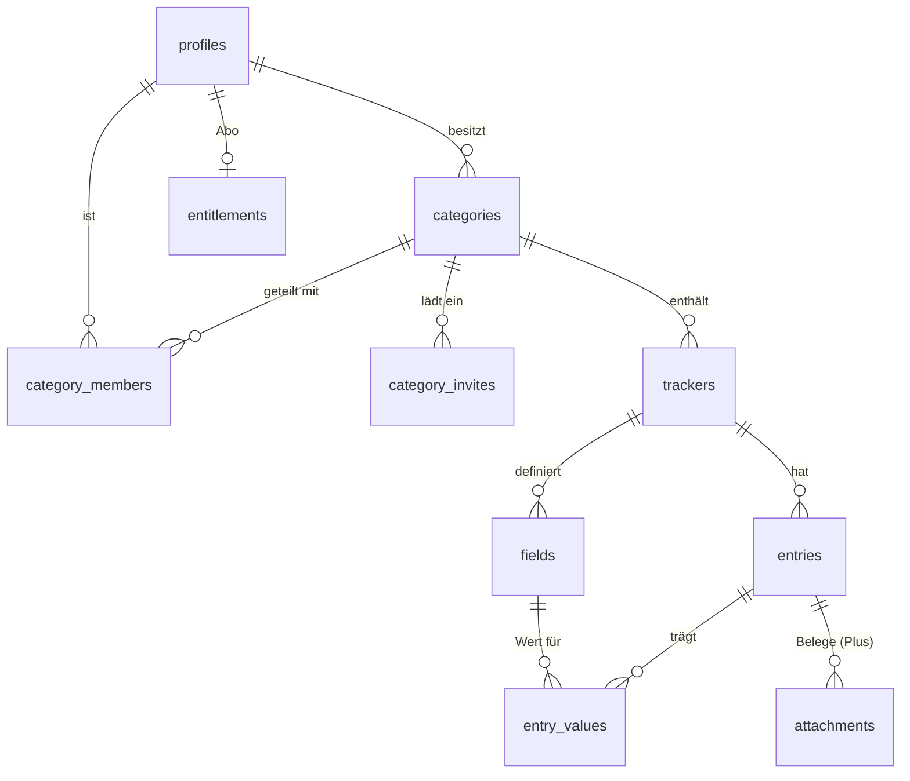

# Supabase – Backend von Kostenkurve

Postgres mit Row Level Security, RPCs für alles, was über Tabellenrechte hinausgeht, Edge Functions für Server-Logik (später: Kaufprüfung, KI-Import). Projekt-Ref: **noch nicht angelegt** – Werte kommen in `.env.local` (Repo-Wurzel, gitignored), nie ins Repo.

```
supabase/
  config.toml          lokale CLI-Konfiguration (anonyme Anmeldung an, Redirect de.eloayoubi.kostenkurve://login-callback)
  migrations/          Schema, eine Transaktion je Datei, Zeitstempel aufsteigend
  seed.sql             Beispieldaten (Demo, Anna) – nur lokal / in test_local.sh
  functions/health/    Lebenszeichen, ohne Anmeldung
  tests/smoke.sql      RLS, Teilen, Wertprüfung, Belege – rollt am Ende zurück
  scripts/test_local.sh  Migrationen + Seed + Tests in einem Wegwerf-Postgres (ohne Docker)
```

## Datenmodell



| Tabelle | Inhalt |
|---|---|
| `profiles` | ein Eintrag je Auth-Nutzer (auch anonym), Anzeigename fürs Teilen. Legt der Trigger `on_auth_user_created` an. |
| `categories` | Strom, Miete, Auto … – Einheit des Teilens. `icon`/`swatch` sind Schlüssel aus der App, `template_key` die Vorlage. |
| `category_members` | Rolle je Person: `owner` (alles, teilt, löscht), `editor` (Tracker, Felder, Einträge), `viewer` (nur lesen). Der owner kommt per Trigger dazu. `sort` ist die Reihenfolge **je Person**: geteilte Kategorien sortiert jeder für sich. |
| `category_invites` | Einladungscode (10 Zeichen, 7 Tage, einmalig) – über `create_category_invite` / `accept_category_invite`. |
| `trackers` | ein Zähler, Vertrag, Auto … innerhalb einer Kategorie. |
| `fields` | frei definierte Felder: `kind` (Text, Zahl, Betrag, Prozent, Datum, Ja/Nein, Auswahl, Formel) und `role` (Zeitverhalten: Stammdatum, Momentwert, Zählerstand, Arbeitspreis, wiederkehrender/einmaliger Betrag, Stichtag). Ein Check erzwingt passende Kombinationen. |
| `entries` | ein Eintrag zu einem Datum, optional Abrechnungszeitraum, `meter_change` beim Zählerwechsel. |
| `entry_values` | typisierte Werte (`num`, `txt`, `dat`, `flag` – genau eine gesetzt). Ein Trigger prüft, dass Feld und Eintrag zum selben Tracker gehören und die Spalte zum Feldtyp passt. Formeln werden in der App berechnet, nicht gespeichert. |
| `entitlements` | Abo-Stand (`free`/`plus`). Nur lesbar – schreiben darf nur die Service-Role (Edge Function nach Kaufprüfung). |
| `attachments` | Belege (JPEG, PNG, HEIC, PDF, ≤ 20 MB) im privaten Bucket `attachments` unter `<category_id>/<entry_id>/<datei>`. Hochladen nur mit Plus; Mitglieder sehen Belege ohne eigenes Abo. |

## RLS in einem Satz

Sichtbar ist, was zu einer Kategorie gehört, in der ich Mitglied bin; schreiben dürfen owner und editor, teilen und löschen nur der owner. Die Hilfsfunktionen `category_role`, `is_category_member`, `can_edit_category`, `is_category_owner`, `tracker_category`, `entry_category` und `has_plus` sind `security definer` mit leerem `search_path`, damit Policies nicht rekursiv werden.

## RPCs

| Funktion | Wer | Was |
|---|---|---|
| `create_category_invite(p_category, p_role = 'editor')` | owner | neuer Code (`text`) |
| `accept_category_invite(p_code)` | angemeldet | tritt bei, liefert die Kategorie-Id; Code danach verbraucht |
| `has_plus()` | angemeldet | hat der Nutzer gerade Plus? |
| `create_category(p_name, p_icon, p_swatch, p_template_key, p_trackers)` | angemeldet | legt Kategorie, Tracker und Felder (aus einer Vorlage) in einer Transaktion an. Läuft mit den Rechten des Aufrufers; scheitert ein Feld an einem Check, bleibt nichts halb angelegt. Liefert die Id. |
| `reorder_categories(p_ids)` | angemeldet | speichert die eigene Reihenfolge (Index in `p_ids`) |
| `save_entry(p_id, p_tracker, p_occurred_on, p_note, p_meter_change, p_values)` | owner, editor | speichert einen Eintrag als Upsert unter der Id vom Gerät, mit allen Werten: Fehlende Felder verlieren ihren Wert, doppeltes Senden ändert nichts. So darf die Offline-Warteschlange beliebig oft wiederholen. |

## Schutz-Trigger

Diese Trigger gelten für angemeldete Nutzer; Server-Code ohne `auth.uid()` ist ausgenommen.

| Trigger | Regel |
|---|---|
| `categories_guard` | `owner_id` bleibt fest; archivieren und wiederherstellen darf nur der owner (umbenennen auch der editor) |
| `trackers_guard` | Tracker bleiben in ihrer Kategorie |
| `entries_guard` | Einträge bleiben in ihrem Tracker |
| `fields_guard` | Felder bleiben in ihrem Tracker; mit gespeicherten Werten wechselt der Typ nur innerhalb derselben Wertspalte (`field_storage`: Zahl/Betrag/Prozent, Text/Auswahl, Datum, Ja/Nein) |

## Lokal testen

```sh
supabase/scripts/test_local.sh
```

Startet ein Wegwerf-Postgres (neuestes installiertes, ≥ 14), stellt die Supabase-Umgebung nach (Rollen, `auth.users`, `auth.uid()`, `storage`), spielt alle Migrationen und den Seed ein und führt `tests/*.sql` aus (`smoke.sql` zuletzt). Muss vor jedem `db push` grün sein. Lokal ist es Postgres 14, Supabase nutzt 17 – PG-15+-Syntax vermeiden oder `brew install postgresql@17`.

## Einspielen

Siehe `CLAUDE.md`, Abschnitt „Supabase-Migrationen einspielen“ (Mac: `npx supabase db push`, Cloud: `.github/workflows/supabase.yml` mit `apply=true`). Einmalig vorher:

```sh
npx supabase login
npx supabase link --project-ref <ref>
npx supabase config push          # Auth-Einstellungen aus config.toml (anonyme Anmeldung, Redirects)
npx supabase db push
npx supabase functions deploy health
```

## Regeln

- Jede Tabelle mit RLS und Policies, jede neue Tabelle mit einem Fall in `tests/`.
- Neue Enum-Werte immer in eine eigene Migration (vor der, die sie benutzt).
- Funktionen, die Rechte prüfen: `security definer` + `set search_path = ''`, Tabellen voll qualifiziert.
- Supabase-Werte nur in `.env.local` – nie in den Chat, ins Repo oder in Logs.
